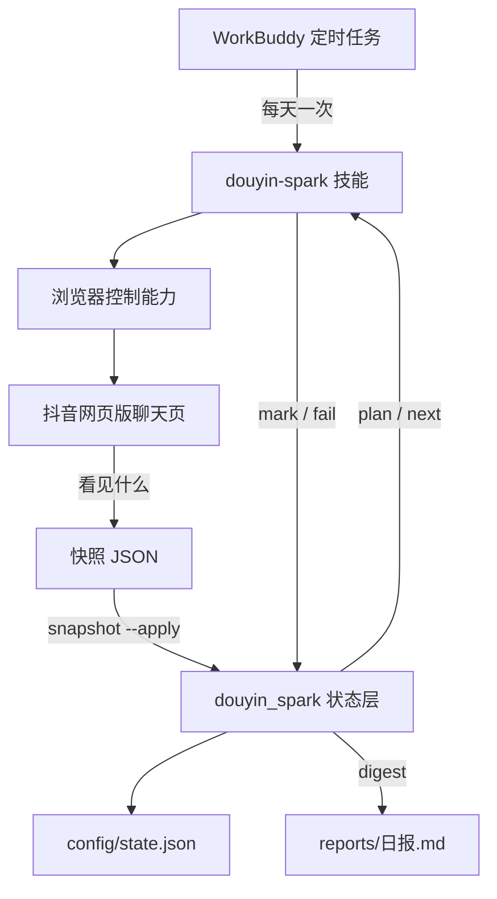

# 🔥 douyin-spark-keeper

   

> 一个不碰 DOM 的抖音续火花方案。浏览器层只负责「看见什么」，状态层只消费一份 JSON。它跑在 WorkBuddy 里，每天一次，失败即停，结果可归档。

## 先说哪里不一样

抖音的互动火花需要双方持续互动才能维持 (unmev, "douyin-auto-fire")。已有方案都把「怎么找到会话」写死在执行层：技能包用固定元素引用，油猴脚本维护选择器表，安卓模块直接读宿主进程会话，云端方案用 Playwright 模拟浏览器 (bazg3452-del, "douyin-spark"; dr-190, "ScriptCat-Douyin-Fire-Helper"; WorldMargin, "SparkFlame"; unmev, "douyin-auto-fire")。

| 方案 | 会话定位 | 失败处理 | 结果产出 |
| --- | --- | --- | --- |
| GitHub Actions 定时 (unmev, "douyin-auto-fire") | Playwright 模拟浏览器 | Dry Run、失败诊断、日志与截图 | 运行日志 |
| LSPosed 模块 (WorldMargin, "SparkFlame") | 注入宿主进程读会话 | 按会话状态跳过 | 会话快照回写界面 |
| 油猴脚本 (dr-190, "ScriptCat-Douyin-Fire-Helper") | DOM 选择器表 + fallback | 自动重试、定时重置 | 历史日志 |
| 技能包 (bazg3452-del, "douyin-spark") | 固定元素引用 | 间隔 1 到 2 秒 | 口头汇报 |
| **本项目** | **快照契约，与 DOM 解耦** | **熔断，达到阈值停止** | **可归档日报** |

本项目的判断是：页面结构属于平台，不由项目维护。项目只维护一份数据格式，以及围绕这份格式的去重、熔断与归档。

## 三个原创设计

### 1. 快照契约：页面改版不用改代码

浏览器层把会话列表整理成一份与页面无关的 JSON，状态层只认这份 JSON。完整字段与校验规则见 [快照契约](docs/snapshot-contract.md)。

```json
{
  "version": 1,
  "captured_at": "2026-11-03T21:00:00",
  "conversations": [
    {"name": "好友甲", "spark_days": 93, "status": "彩色", "reignite_progress": ""},
    {"name": "好友乙", "spark_days": 2, "status": "重燃中", "reignite_progress": "2/3"}
  ]
}
```

导入分两步，先看后写，避免一份坏数据污染状态：

```bash
python -m douyin_spark snapshot --file snapshot.json
python -m douyin_spark snapshot --file snapshot.json --apply
```

页面改版时，使用者只需重新生成这份 JSON，命令行程序与技能定义都不用动。程序不推算火花天数与重燃进度，字段值一律来自页面显示。

### 2. 熔断：失败即停，而且能说清为什么停

上游方案多侧重重试与诊断 (dr-190, "ScriptCat-Douyin-Fire-Helper"; unmev, "douyin-auto-fire")。本项目反过来：发送失败用 `fail` 记录原因，当日失败数达到阈值（默认 2）后，`plan` 直接返回空名单并输出熔断提示，当天不再继续发送。跨天自动清零。

```bash
python -m douyin_spark fail "好友甲" --reason "页面未找到会话"
python -m douyin_spark status
```

这样每天的任务要么完成，要么带着明确原因停下，不会出现连续重试轰炸。

### 3. 日报：把每天的结果留下来

`digest` 生成一份 Markdown 日报，写入 `reports/YYYY-MM-DD.md`，包含联系人、今日已发、待发、失败数、熔断状态、联系人明细、当日消息与快照记录。日报可归档、可对比，不依赖任何外部服务。

```bash
python -m douyin_spark digest
```

## 它怎么跑起来



调度层、执行层、状态层彼此只通过命令与 JSON 通信。使用者在 WorkBuddy 设置里开启浏览器控制能力，并在本机 Chrome 或 Edge 保持抖音网页版已登录。

## 快速开始

```bash
git clone https://github.com/boreyaa/douyin-spark-keeper.git
cd douyin-spark-keeper
cp config/messages.example.json config/messages.json
python -m douyin_spark --help
python -m douyin_spark add "好友昵称" --days 93 --status 彩色
python -m douyin_spark plan
```

接入 WorkBuddy：把 `integrations/workbuddy/SKILL.md` 复制到 `~/.workbuddy/skills/douyin-spark/SKILL.md`，把文件里的 `PROJECT_ROOT` 替换为仓库绝对路径。每日定时任务的参数与自包含提示词见 `integrations/workbuddy/AUTOMATION.md`。

> ⚠️ 定时任务一旦启用就会每天自动向好友发送消息。首次使用建议先手动跑 `plan` 与 `next`，确认名单和消息无误后再启用。

## 命令一览

| 命令 | 作用 |
| --- | --- |
| `list` / `add` / `remove` | 联系人清单 |
| `snapshot --file PATH [--apply]` | 校验并导入会话快照 |
| `plan` | 今日待发名单，熔断时返回空 |
| `next` | 取下一条消息，避开上一条内容 |
| `mark NAME --text TEXT` | 记录发送成功 |
| `fail NAME --reason TEXT` | 记录发送失败，累计触发熔断 |
| `set NAME --days N --status ...` | 按页面读数更新字段 |
| `status` / `report` | 当日进度与结果表格 |
| `digest [--out PATH]` | 生成 Markdown 日报 |
| `dump` | 输出完整状态 JSON |

全局参数：`--state PATH`、`--templates PATH`。完整说明见 [命令参考](docs/commands.md)。

## 项目结构

```
douyin-spark-keeper/
├── douyin_spark/          # 状态层，只用 Python 标准库
│   ├── cli.py             # 子命令入口
│   ├── state.py           # 状态、快照导入、熔断、日报
│   ├── snapshot.py        # 快照契约校验
│   └── messages.py        # 模板轮换
├── config/                # 配置示例，运行时状态不入库
├── docs/                  # 快照契约、WorkBuddy 集成、命令参考
├── integrations/workbuddy/# 技能定义与定时任务参数
├── reports/               # 日报输出，不入库
├── tests/                 # 单元测试与端到端冒烟
├── .github/               # CI、Issue 与 PR 模板
├── README.md
├── CHANGELOG.md
├── CONTRIBUTING.md
├── LICENSE
└── pyproject.toml
```

## 文档

- [快照契约](docs/snapshot-contract.md) —— 本项目独有的数据格式与两阶段导入
- [WorkBuddy 集成说明](docs/workbuddy.md) —— 技能安装、定时任务、故障排查
- [命令参考](docs/commands.md)
- [更新日志](CHANGELOG.md) · [贡献指南](CONTRIBUTING.md)

## 测试

```bash
python -m unittest discover -s tests -v
```

测试覆盖状态管理、跨天重置、模板不重复、快照校验与导入、熔断触发与清零、日报生成，以及命令行端到端流程。GitHub Actions 在 Python 3.10 至 3.13 上运行同一套测试。

## 边界与声明

- `config/state.json`、`config/messages.json` 与 `reports/` 含好友昵称与发送历史，不要提交到公开仓库。
- 每个会话每天最多记录一次发送，相邻两次间隔 1 到 2 秒；失败达到阈值即熔断。
- 项目不接管登录，不读取或保存 Cookie、Token、账号密码，不提供绕过登录、验证码或平台风控的能力。
- 使用第三方自动化工具维持互动标识可能不符合平台服务条款，相关风险由使用者自行评估。
- 灰色火花、彩色火花、重燃中 X/3 三类状态描述来自第三方技能页面 (bazg3452-del, "douyin-spark")，未经平台官方公告核实；本项目只记录页面读数。

## 参考项目

本项目的仓库组织方式参考了以下开源项目，代码、契约与文档均为独立编写：

- (unmev, "douyin-auto-fire")
- (WorldMargin, "SparkFlame")
- (dr-190, "ScriptCat-Douyin-Fire-Helper")
- (bazg3452-del, "douyin-spark")

## License

[MIT](LICENSE)
